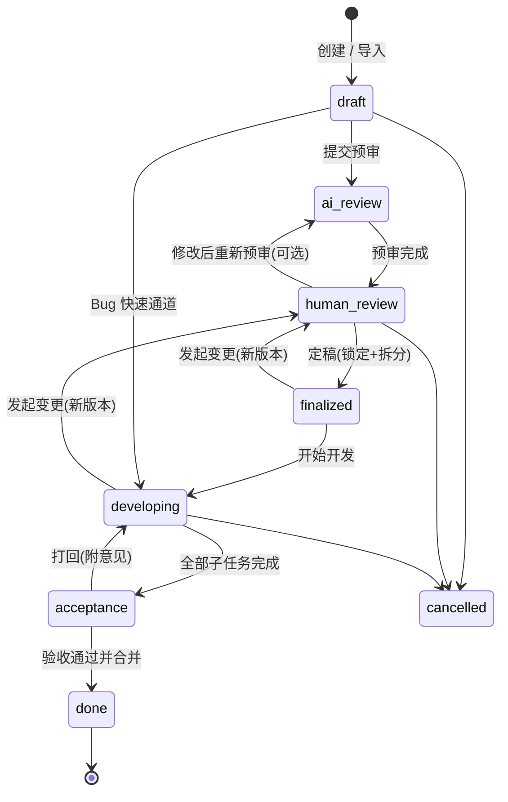

# 工作流与状态机

## 1. 工单状态【已确认】



| 状态 | 中文 | 含义 | 退出条件 |
| --- | --- | --- | --- |
| `draft` | 草稿 | 刚创建或导入，PRD 可随意编辑 | 提交预审；Bug 可直接开始开发 |
| `ai_review` | AI 预审中 | Agent 正在阅读 PRD 与项目代码，生成问题清单 | 预审运行结束（成功或失败均进入人工审核，失败时提示可重试） |
| `human_review` | 人工审核 | 处理问题清单、编辑 PRD、产生新版本 | 无"阻塞"级未处理问题时可定稿 |
| `finalized` | 已定稿 | PRD 锁定，子任务已拆分确认 | 点击"开始开发"或自动开始（设置项） |
| `developing` | 开发中 | 子任务按依赖顺序排队运行 | 所有子任务处于 `review`/`accepted` |
| `acceptance` | 验收中 | 人工看 Diff、跑测试、实际体验 | 通过 → 合并 → 完成；不通过 → 打回 |
| `done` | 已完成 | 代码已合并，worktree 可清理 | — |
| `cancelled` | 已取消 | 放弃 | 可恢复到取消前状态 |

## 2. 关键流转规则

1. **定稿前置条件**：所有 `blocker` 级问题必须处理（采纳、手动修改或标记忽略并写理由）；验收标准不为空。
2. **定稿动作**（原子操作）：锁定当前版本为 `finalized_version` → 运行"拆分"生成子任务建议 → 人工确认子任务 → 创建分支与 worktree。
3. **开发调度**：
   - 无依赖的子任务立即入队；
   - 混合需求中，FE 子任务依赖 BE 子任务的 `api_doc` 产物，BE 先跑；
   - 【建议】BE 子任务的 Prompt 被要求"先写 API 文档并提交，再实现"，系统检测到 API 文档文件出现即解锁 FE（无需等 BE 完全实现），从而前后端可并行。
4. **验收**：每个子任务独立验收，可以只打回其中一个。工单级"验收通过"要求所有子任务 `accepted`。
5. **打回**：填写意见（可在 Diff 行上评论）→ 子任务状态 `changes_requested` → 自动创建新的 Run，Prompt = 原任务 + 打回意见 + 行内评论；优先**恢复原 Agent 会话**（resume），失败则新开会话并附上一轮摘要。
6. **合并**：验收通过后，按设置执行 merge / squash 到目标分支；冲突时提示在 IDE 中解决，或派一个"解决冲突"Run。

## 3. Bug 快速通道【已确认】

```
draft ──(开始修复)──▶ developing ──▶ acceptance ──▶ done
```

- 跳过 `ai_review` 与 `human_review`，PRD 版本仍会保存（Bug 描述也有版本）。
- 【建议】可选"复现优先"模式：Agent 第一步先写一个能复现 Bug 的失败测试，再修复，使测试由红变绿作为验收证据。
- Bug 也可以手动送去 AI 预审（例如描述太模糊时）。

## 4. 子任务状态

```
pending ─▶ queued ─▶ running ─▶ review ─▶ accepted ─▶ merged
   ▲          │          │         │
blocked       │       failed/     changes_requested ─▶ queued
(等依赖)     cancelled  stopped
```

- `failed`（进程异常退出或测试失败）与 `stopped`（人工停止）都可"重试"或"恢复"。
- 自动测试失败时，可配置"自动修复 N 次"：把失败输出喂回 Agent 再跑，超过次数转人工。

## 5. 定稿后的变更【已确认】

- 定稿后 PRD 只读。需要改需求时点"发起变更"，填写变更原因。
- 系统基于定稿版本生成新草稿版本，工单回到 `human_review`（可选再次 AI 预审，仅审查变更部分）。
- 正在运行的子任务：提示用户选择"继续跑完"或"立即停止"。
- 再次定稿时，AI 对比新旧定稿版本生成**影响分析**：哪些子任务需要追加工作、哪些不受影响、是否需要新增子任务。已完成的子任务以"增量 Run"的形式在原 worktree 继续。

## 6. 自动化与触发器【建议】

| 触发 | 动作（可在设置中开关） |
| --- | --- |
| 预审完成 | Windows 通知"有 N 个问题待处理" |
| 定稿 | 自动开始开发 |
| BE 产出 API 文档 | 解锁 FE 子任务并入队 |
| 运行结束 | 自动跑测试；失败则自动修复（最多 N 次） |
| 全部子任务完成 | 工单进入验收，通知 |
| 合并完成 | 清理 worktree，归档运行日志 |
