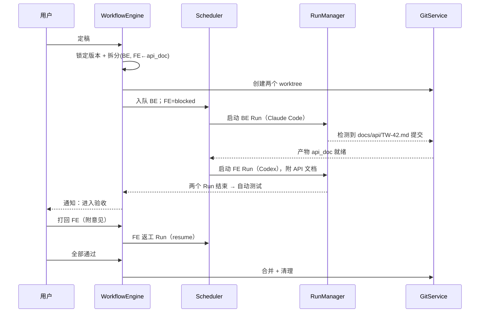

# 系统架构

## 1. 技术选型【已确认 + 建议】

| 层 | 选型 | 理由 |
| --- | --- | --- |
| 桌面壳 | **Tauri 2**（备选 Electron） | 安装包小、内存占用低、Rust 后端便于进程管理与 Windows API 调用；见 [ADR-0001](../adr/0001-desktop-shell-tauri.md) |
| 前端 | React + TypeScript + Vite | 生态成熟 |
| UI 组件 | shadcn/ui（Radix + Tailwind） | 美观、可定制 |
| 编辑器 | Milkdown / TipTap（Markdown 所见即所得）+ Monaco（Diff 视图） | PRD 编辑与代码 Diff |
| 后端核心 | Rust（Tauri commands） | 进程、git、文件、数据库 |
| 数据库 | SQLite（`sqlx` 或 `rusqlite`）+ FTS5 全文检索 | 本地优先、零运维；见 [ADR-0005](../adr/0005-local-first-sqlite.md) |
| git 操作 | 调用系统 `git` CLI（worktree 支持最完整），只读查询可用 `git2` | 行为与用户日常一致 |
| 文档解析 | `pandoc`（可选依赖）/ `mammoth` / `pdf.js` | 见 [工单来源](../02-workflow/ticket-sources.md) |
| 密钥 | Windows 凭据管理器（`keyring` crate） | 不明文落盘 |

> 若选 Electron：后端核心改为 Node（`child_process`、`better-sqlite3`、`simple-git`），其余设计不变。

## 2. 模块划分

```
┌──────────────────────────── Tauri WebView（React） ────────────────────────────┐
│ 看板/列表 │ 工单详情 │ PRD 审核 │ 运行面板 │ Diff/验收 │ 项目 │ Provider │ 设置 │
└───────────────▲──────────────────────────────────────────────▲─────────────────┘
                │ invoke (commands)                             │ events (流式日志/状态)
┌───────────────┴────────────────── Rust Core ─────────────────┴─────────────────┐
│  TicketService     WorkflowEngine     ReviewService      ImportService          │
│  ProjectService    TaskSplitter       PromptBuilder      ProviderRegistry       │
│  Scheduler(队列/并发/依赖)  RunManager(进程/Job Object)  AgentAdapters          │
│  GitService(worktree/diff/merge)  TestRunner  CostMeter  Notifier  SecretStore  │
│                               Repository (SQLite)                               │
└────────────────────────────────────┬──────────────────────────────────────────┘
                                     │ spawn
                 ┌───────────────────┼────────────────────┐
              claude (CLI)        codex (CLI)        git / 测试命令 / LiteLLM(可选)
```

| 模块 | 职责 |
| --- | --- |
| `WorkflowEngine` | 状态机：校验转换、执行转换副作用（锁定版本、创建 worktree、入队），发出领域事件 |
| `ReviewService` | 调用预审 / 规整 / 拆分 / 影响分析，解析结构化结果 |
| `Scheduler` | 维护队列、并发上限、依赖解锁；监听 API 文档产物 |
| `RunManager` | 启动、停止、恢复进程；读取 stdout/stderr；超时与预算护栏 |
| `AgentAdapters` | 各 Agent 的命令构造与事件解析 |
| `ProviderRegistry` | Provider 配置、选择优先级、连通性测试、注入参数生成 |
| `GitService` | worktree、分支、自动提交、Diff、合并、清理 |
| `TestRunner` | 执行项目命令、收集报告 |
| `CostMeter` | 汇总 Token / 费用 |
| `Notifier` | Windows 通知、托盘状态 |

## 3. 领域事件

模块间通过事件解耦（进程内事件总线），同时写入工单时间线。【建议】有外部副作用的操作（启动 / 停止 Run、回复审批、打检查点）改为"命令 + 事件 + 待执行副作用同一事务落盘，再由 worker 执行"，命令可幂等重试，重启后据此恢复，见 [Agent 管理 §10](../03-agent/agent-management.md)：

`TicketCreated`、`PrdVersionCreated`、`ReviewCompleted`、`TicketFinalized`、`TaskUnblocked`、`RunStarted`、`RunEvent`、`RunFinished`、`TestsFinished`、`TaskRejected`、`TaskAccepted`、`TicketMerged`、`ChangeRequested`。

## 4. 关键时序：混合需求从定稿到验收



## 5. 应用生命周期

- 启动：环境检测（git / claude / codex 版本）、恢复未完成 Run 的状态（标记 `orphaned`）、清理残留进程。
- 托盘常驻：关闭窗口不退出，运行中的任务继续；托盘图标显示运行数。
- 退出：有运行中任务时确认。
- 更新：Tauri updater（P1）。检查更新只读 GitHub 上最新发布的版本号；有新版本时用户点「下载并安装」并确认后，才从发布页的 `latest.json` 找到安装包下载，用打包时内置的公钥校验签名，通过后安装并重启（Windows 上交给 NSIS 安装程序）。校验不过不安装；有运行在进行时不安装；没有内置公钥的构建只给出发布页地址。

### 发布新版本

发版由 `.github/workflows/release.yml` 完成，推送标签即触发：

1. 把 `Cargo.toml`、`package.json`、`src-tauri/tauri.conf.json` 三处版本号改成同一个新版本，合并进 main。
2. 在 main 上打标签并推送：`git tag v<版本号> && git push origin v<版本号>`。标签和版本号不一致时工作流直接报错，不发布。
3. 工作流在 Windows 上构建 NSIS 安装包，建一个同名的 GitHub Release（发布说明自动生成），把安装包传上去。几分钟后在仓库的 Releases 页能看到。

想先试一次构建而不发布：在 Actions 页选 Release 工作流点 Run workflow，安装包留在那次运行的 Artifacts 里。

发错了：在 Releases 页删掉这个 Release 和标签，修好后重新打同一个标签。

**签名与应用内更新**（一次性准备，不做也能发版，只是用户要从发布页手动下载安装）：

1. `npx tauri signer generate -w tidewatch.key` 生成签名密钥。
2. 私钥（`tidewatch.key` 的内容）存成仓库 Secret `TAURI_SIGNING_PRIVATE_KEY`；设了密码再加 `TAURI_SIGNING_PRIVATE_KEY_PASSWORD`。私钥丢了，已经装出去的版本就再也收不到应用内更新。
3. 公钥（`tidewatch.key.pub` 的内容）写进 `src-tauri/tauri.conf.json` 的 `plugins.updater.pubkey`，合并进 main。

配了 Secret 之后，工作流会给安装包签名，并多发布 `.sig` 和应用内更新读的 `latest.json`。应用内安装要两头都齐：用户手里的版本内置了公钥，新版本带签名。
